<p align="center">
  <a href="https://neyuhealth.com"></a>
</p>

<p align="center">
  <a href="https://neyuhealth.com"></a>
  
  
  
  
  
  
</p>

<h3 align="center">An AI-enabled health platform for cardiology, prevention and longevity, built in Calgary, Alberta.</h3>

<p align="center">
  <b><a href="https://neyuhealth.com">neyuhealth.com</a></b> &nbsp;·&nbsp;
  <a href="#platform-overview">Overview</a> &nbsp;·&nbsp;
  <a href="#neyu-ai">Neyu AI</a> &nbsp;·&nbsp;
  <a href="#architecture">Architecture</a> &nbsp;·&nbsp;
  <a href="#security-and-privacy">Security</a> &nbsp;·&nbsp;
  <a href="#performance">Performance</a> &nbsp;·&nbsp;
  <a href="#quality-assurance">Quality</a>
</p>

---

## Platform overview

NEYU Health connects four things that are usually separate: a specialist clinic's public website, each patient's own health record, the clinic's operations console and an AI companion (**Neyu**) that works across all three.

<p align="center"></p>

| Product | Users | What it does |
|---|---|---|
| **Website** · 58 pages | the public | 10 specialty pages, 5 diagnostic services, virtual care, the Virtual Hypertension Clinic, membership, packages, at-home care, physicians, referral centre, and 15 AI tools (symptom check, lab explainer, visit prep and more) |
| **My Health Space** · 12 screens | patients | one record for labs, reports from any provider, wearables, blood pressure, food, goals, appointments and family; Neyu explains it all in plain language |
| **Admin Console** · 14 screens | clinic staff | patients (360° view), referrals, service requests, inbox, AI activity review, visitors, insights, analytics, privacy requests, audit log, staff and roles |
| **NEYU phone app** | patients | iPhone and Android app around My Health Space, with Apple Health, Health Connect, push notifications, Face ID and the share sheet |

> **Clinical safety rule:** Neyu never diagnoses. It explains, organises and points to care. Emergency language triggers *call 911 / go to the nearest emergency department* before any AI call, both in the browser and on the server.

---

## Neyu AI

Neyu is built into every part of the platform, with **22 AI features** on Google Gemini. Every feature has the same safety layers and a **rules-based fallback**, so patients and staff always get a useful answer even when the AI service is slow or unavailable.

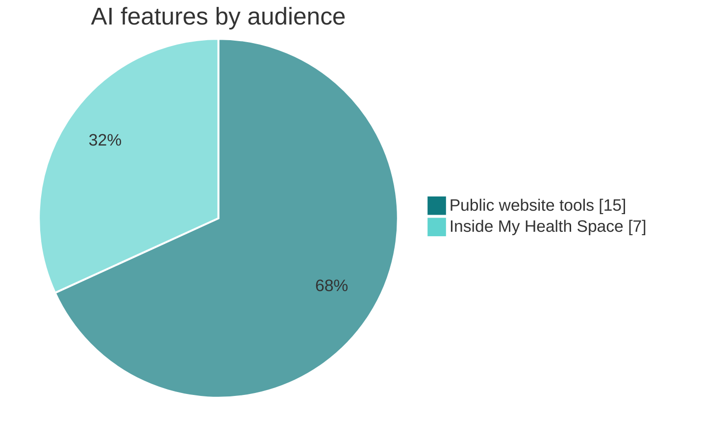

### Public website: 15 AI tools

| Tool | What it does |
|---|---|
| **Neyu chat** | site-wide assistant that knows the page the visitor is on; every conversation is logged for clinical review |
| **Concierge** | understands a free-text need and routes the visitor to the right real service (it can only choose destinations that exist) |
| **Symptom check** | free-text symptoms → structured, non-diagnostic triage suggestion (cardiology and respiratory) |
| **Lab explainer** | explains lab values and ranges in plain language |
| **Explain my diagnosis** | turns a diagnosis name into a clear explanation with questions to ask |
| **Visit prep** | builds the patient's question list and a checklist for a visit |
| **Referral autofill** · **Referral generator** | extract the structured referral form from a physician's free-text note |
| **Physician match** | suggests the right specialist for a described need |
| **Longevity risk** | explains a guideline-based risk score |
| **Assessments** | write-ups for the Longevity, Genomics and Longevity Lab assessments (scores computed from published guidelines; the AI only explains them) |
| **Genomics quiz** | recommends real BioAro Labs tests from the live catalogue |
| **Nutrition plan** | a personal nutrition plan from goals and preferences |
| **Nea skin: ask** · **Nea skin: match** | answers and treatment matches using only Nea's published information |

### Inside My Health Space: 7 features on the patient's own data

| Feature | What it does |
|---|---|
| **Neyu in My Health** | answers questions about the patient's *own* records, only when the patient has switched Neyu access on, and only from the sources they allow |
| **Document reading** | a PDF or photo of any report becomes structured values plus a plain-language summary; the original file is kept unchanged and the reading is labelled as AI |
| **Daily brief (Today)** | a short morning message from the patient's own data, local weather and air quality (ECCC weather + AQHI) |
| **Monthly health story** | a recap of each month: what changed, what improved, what to watch |
| **Food log** | meals logged by text or photo; Neyu tags each meal and spots gentle patterns (no calorie counting) |
| **AI health plan** | a personal plan built from the patient's current data, refreshed on request |
| **Doctor assessment** | the patient's data for a chosen period plus Neyu's observations and suggested questions, ready for the visit |

### How every AI request is handled

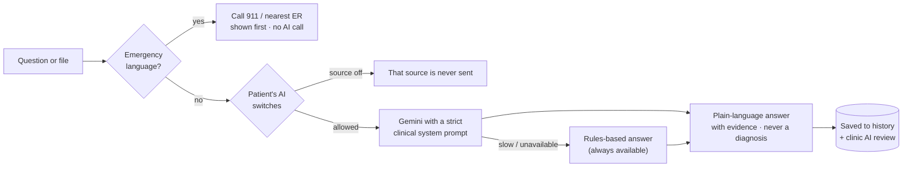

| Safety layer | How it works |
|---|---|
| Emergency safety net | fixed keyword rules run **before** the AI and again on the server; they can't be switched off |
| Consent | each AI permission is a recorded consent with its policy version; the patient decides which data sources Neyu may read |
| No diagnosis | the clinical prompts forbid diagnosing; answers point to a clinician and never suggest changing a medicine |
| Transparency | AI content is labelled as Neyu's; originals are never changed |
| Clinical oversight | the **AI Activity** console screen shows every conversation, with emergency flags reviewed first |
| Resilience | timeouts, one retry, tolerant JSON reading and a rules-based fallback for every feature |

---

## Patient experience: My Health Space

| Screen | What the patient can do |
|---|---|
| **Today** | daily brief, today's readings, reminders and what Neyu noticed |
| **My Health** (Health Map) | everything in one map: labs, reports, wearables, check-ins |
| **Records** | reports from any provider; upload, scan or photograph, and Neyu reads it; share a **Doctor Report** PDF |
| **Results** | lab results next to wearable data, with retest reminders |
| **Trends** | any metric over 7 days to 1 year, by category |
| **Health profile** | a complete baseline in five sections, filled automatically from devices and check-ins |
| **Neyu Intelligence** | the monthly story and proactive "Neyu noticed" insights |
| **Health Universe** | home blood pressure (Heart), lifestyle, family and sharing, caring for someone else, rewards and challenges |
| **Protocol** | a personal programme with daily items and a log |
| **Appointments** | upcoming and past visits, with visit questions |
| **Devices** | connect Apple Health, Health Connect, Withings, Oura and WHOOP |
| **Account** | profile, notifications, **Privacy & Data** (consents, AI switches, export, deletion) |

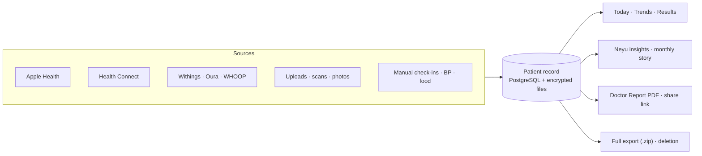

---

## Clinic operations: Admin Console

| Screen | Purpose |
|---|---|
| **Overview** | today's numbers, open work and alerts at a glance |
| **Patients** · **Patient 360** | search patients; one record with sections that open only with permission (and a written reason where required) |
| **Referrals** | incoming physician referrals and their status |
| **Requests** | service requests: virtual care, hypertension clinic, packages, membership, at-home care |
| **Inbox** | messages and follow-ups in one place |
| **AI Activity** | every Neyu conversation, emergency flags first |
| **Visitors** · **Analytics** · **Insights** | traffic, sources (including AI assistants such as ChatGPT and Perplexity), searches, top questions to Neyu, conversion to patients; anonymous counts only |
| **Privacy requests** | account deletions (30-day hold) and data exports |
| **Audit log** | every action, sign-in and refusal, with a 14-day chart and CSV export |
| **Settings → Staff** | add staff, choose Super admin or Admin with selected features, require 2-step codes |

**Roles:** Super admin · Organization admin · Clinic manager · Care staff · Physician · Support, with **22 permissions** such as `patients.record.read`, `reports.send`, `privacy.deletion.manage` and `audit.read`.

---

## Architecture

<p align="center"></p>

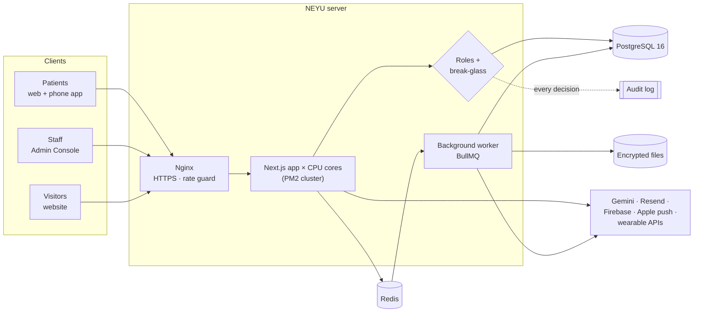

### Data model (core)

62 tables across eight versioned migrations. The core relationships:

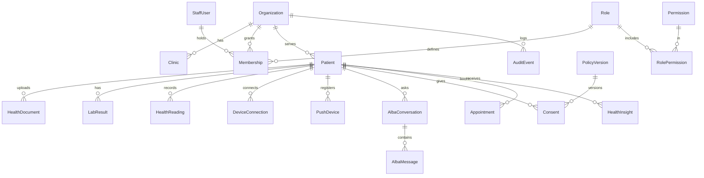

### Background jobs

| Job | Schedule | Purpose |
|---|---|---|
| `daily` | hourly | wearable sync, daily briefs, visit and retest reminders, push notifications |
| `stats.warm` | every 10 min / hourly | pre-computes dashboards so the console opens instantly |
| `visitors.backfill` | hourly | daily visitor totals |
| `privacy.sweep` | hourly | runs deletions when the 30-day hold ends |
| `sessions.cleanup` | nightly | removes expired sessions |
| `email.send` · `privacy.export` | on demand | codes and reminders with retries; data-export .zip files |

---

## Security and privacy

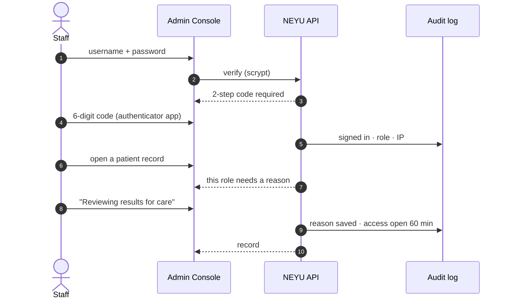

| Layer | Protection |
|---|---|
| **Sign-in** | personal staff accounts · scrypt password hashing · TOTP 2-step codes · lock after repeated failures · patients verify email with a 6-digit code · only token hashes are stored |
| **Access control** | 6 roles × 22 permissions · nobody can grant more than they hold · the last super admin can't be removed · a recovery super admin is defined in server settings |
| **Break-glass** | sensitive records need a written reason, saved in the audit log; access closes after 60 minutes |
| **Audit** | append-only log of every view, change, export, refusal and sign-in, including background jobs |
| **Encryption** | HTTPS everywhere (HSTS); report files and exports encrypted at rest with AES-256-GCM; wearable sign-in tokens encrypted |
| **Abuse protection** | rate limits on every API (shared through Redis) plus an extra Nginx guard on sign-in; same-origin checks |
| **Patient rights** | versioned consents with re-acceptance when policies change · email preferences with one-click unsubscribe · full data export (.zip) · account deletion with a 30-day hold and a deletion certificate |
| **Legal pages** | Privacy Policy, Terms of Use, Neyu AI notice, Cookies (statistics opt-out, honours Do Not Track / GPC) and Accessibility statement; 18+ sign-up |
| **Accessibility** | WCAG 2.1 AA: 0 serious issues across 20 page views on desktop and phone (axe) |
| **Jurisdiction** | data stored in Canada; designed for Alberta's *Health Information Act* and *PIPEDA* |

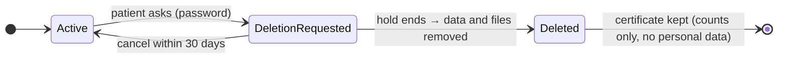

---

## Phone app

The NEYU app for iPhone and Android (Capacitor 8) opens My Health Space and adds native features. Website updates reach the app immediately, with no store update needed. Builds run in the cloud on GitHub Actions. Guide: [`mobile/README.md`](mobile/README.md).

| Native feature | Details |
|---|---|
| Apple Health · Health Connect | read-only; the patient chooses the data types; the last 30 days, then new days each time the app opens |
| Push notifications | Firebase (Android) and Apple push, sent by NEYU's own server; no health details on the lock screen |
| Face ID · fingerprint lock | on open and after 2 minutes away; biometrics never leave the phone |
| Share sheet · camera | PDFs and exports to Files, Print or Mail; scan reports and meals |
| Withings · Oura · WHOOP | sign-in in the phone's browser via a one-time link, then back to the app |
| Offline handling | offline banner and a retry screen |

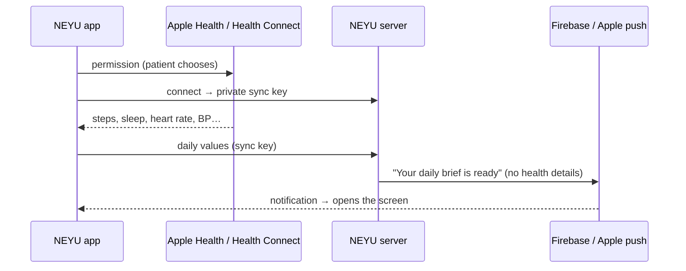

---

## Performance

Load-tested with k6 against **one year of production-sized data** (1.8 million visitors, 5.4 million page views, 15,000 patients). Mix: 75 % website visitors, 22 % patients, 3 % staff, **200 users at the same time**, which is twice the expected peak for 5,000 visitors a day. Errors: **0**.

```mermaid
%%{init: {"themeVariables": {"xyChart": {"plotColorPalette": "#BFE9E7, #0F7A80"}}}}%%
xychart-beta
  title "95th-percentile response time vs target (seconds)"
  x-axis ["Website pages", "My Health Space", "Console dashboards"]
  y-axis "seconds" 0 --> 2
  bar [0.8, 1.0, 2.0]
  bar [0.23, 0.50, 0.76]
```

<sub>Light bars: target · dark bars: measured.</sub>

| Technique | Effect |
|---|---|
| PostgreSQL 16 tuned, with an index for each query path and a BRIN index on the audit log | fast lookups at millions of rows |
| Pre-computed daily totals and worker-warmed dashboard cache | a year of analytics opens in under a second |
| Redis shared state (rate limits, sign-in guards, cache, job queue) | any number of app copies behave as one |
| PM2 cluster, one app copy per CPU core, zero-downtime reloads | more traffic per server; updates without dropping requests |
| Cursor pagination in `/api/v1`; files outside the database | constant-time pages; a small, fast database |
| Health and metrics endpoints (`/api/v1/health`, Prometheus `/api/v1/metrics`) | uptime monitoring and alerts |
| Graceful fallback without Redis | the app keeps running if Redis is down |

---

## Quality assurance

**608 automated checks, all passing**, plus accessibility and load tests.

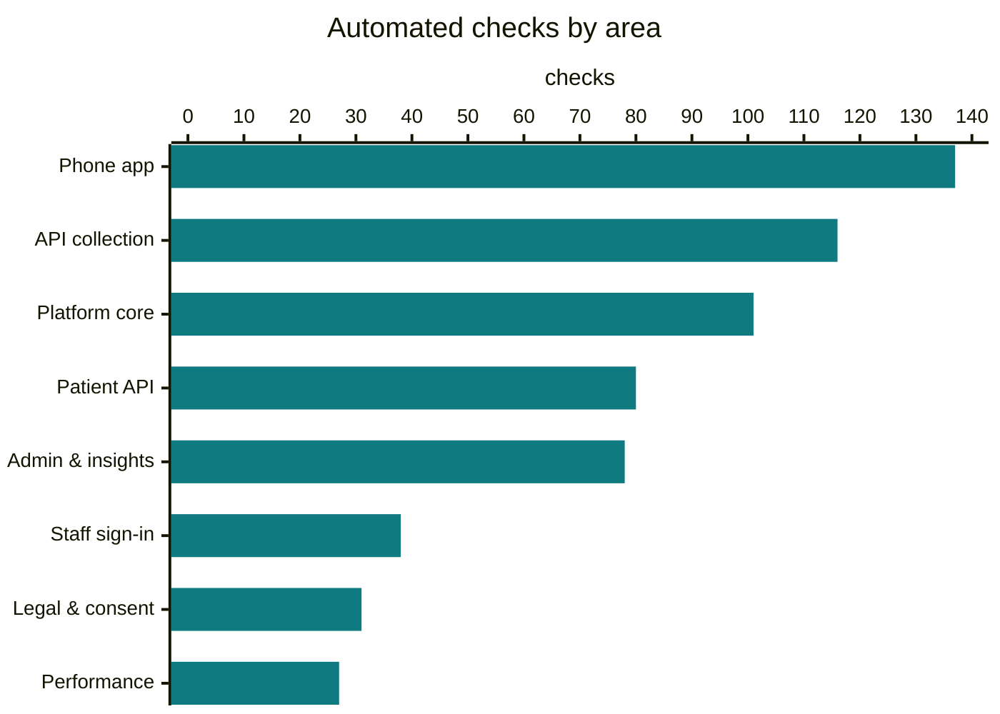

| Suite | Checks | Covers |
|---|---:|---|
| Platform core | 101 | break-glass, staff management, audit, privacy, file storage, Redis, worker, API v1 |
| Patient API | 80 | My Health Space end to end |
| API collection (Postman / Newman) | 116 | 81 requests across website, patient, admin, API v1, phone app and legal |
| Admin and insights | 78 | recovery super admin, admins with selected features, live access changes, insights, SEO |
| Phone app | 137 | push for Android and iPhone, device clean-up, health data sync and mapping (units, local days, sleep stages), app features in a browser |
| Staff sign-in | 38 | passwords, 2-step codes, lock-outs, replay protection |
| Legal and consent | 31 | legal pages, policy versions, re-acceptance, 18+ rule, statistics opt-out |
| Performance | 27 | a year of data: dashboards, daily totals, background jobs, health and metrics, caching |
| Accessibility (axe, WCAG 2.1 AA) | 0 serious | 20 page views, desktop and phone |
| Load test (k6) | 200 at once | 0 errors, every target met |

---

## Technology

| Layer | Technology |
|---|---|
| Web | Next.js 15 (App Router) · React 18 · TypeScript · Tailwind CSS |
| API | Route handlers · versioned `/api/v1` with zod validation, OpenAPI 3.1, request IDs and rate-limit headers |
| Data | PostgreSQL 16 · Prisma 5 · Redis 7 · BullMQ |
| AI | Google Gemini with rules-based fallbacks |
| Files | encrypted local storage (S3-compatible driver ready) |
| Email | Resend (SMTP) · one-click unsubscribe |
| Mobile | Capacitor 8 · Apple HealthKit · Android Health Connect · FCM HTTP v1 · APNs |
| Operations | Nginx · Let's Encrypt · PM2 cluster · daily backups · health and metrics endpoints |
| Testing | Node test suites · Postman / Newman · Playwright · axe-core · k6 |

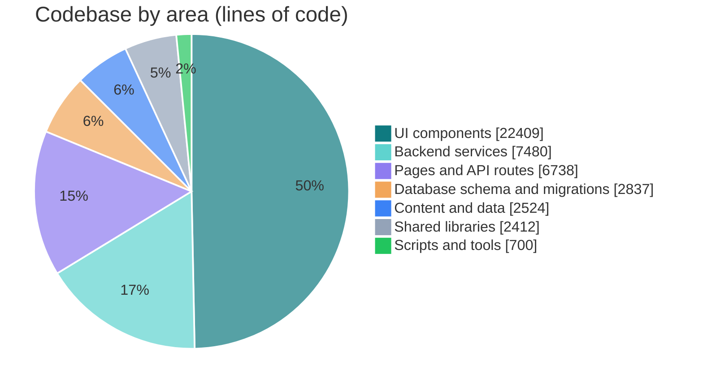

---

## Repository

```
src/app/            pages and API routes (src/app/api/v1 = versioned API)
src/components/     website, My Health Space and Admin Console UI
backend/            services: auth, access control, privacy, storage, queue, AI
prisma/             schema and migrations
scripts/            seed, import, staff accounts, worker, storage tools
postman/            API test collection
loadtest/           k6 load test and test-data scripts
mobile/             iPhone and Android app (Capacitor)
.github/workflows/  cloud builds of the phone app
deploy/             server setup, go-live runbook, checks, backups, monitoring
docs/               development guide, legal guide, specifications
```

| Guide | |
|---|---|
| Local development and tests | [`docs/DEVELOPMENT.md`](docs/DEVELOPMENT.md) |
| Server and go-live | [`deploy/README.md`](deploy/README.md) · [`deploy/GO-LIVE.md`](deploy/GO-LIVE.md) |
| Monitoring and alerts | [`deploy/MONITORING.md`](deploy/MONITORING.md) |
| Phone app | [`mobile/README.md`](mobile/README.md) |
| Legal pages | [`docs/LEGAL.md`](docs/LEGAL.md) |

<p align="center"><sub>© 2026 NEYU Health · Calgary, Alberta · <a href="https://neyuhealth.com">neyuhealth.com</a> · Neyu gives wellness information, not a diagnosis. In an emergency call 911.</sub></p>
