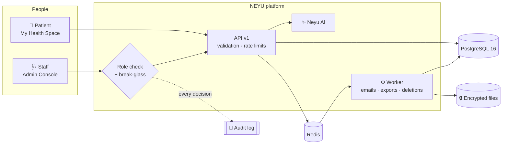
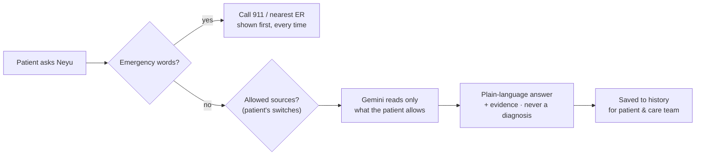
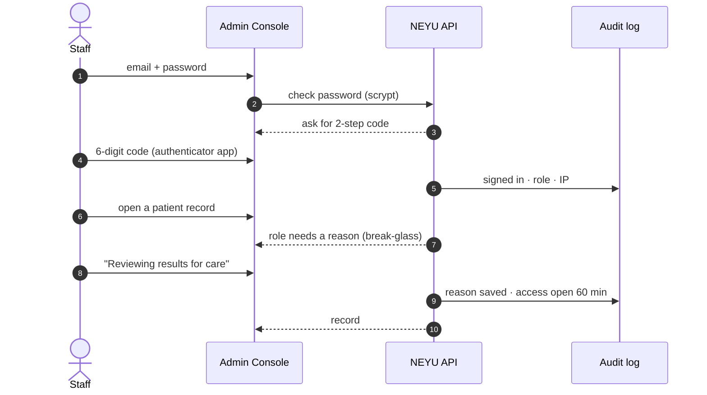
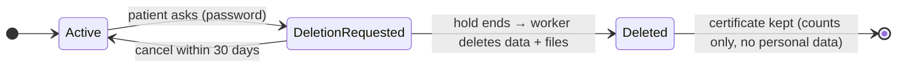
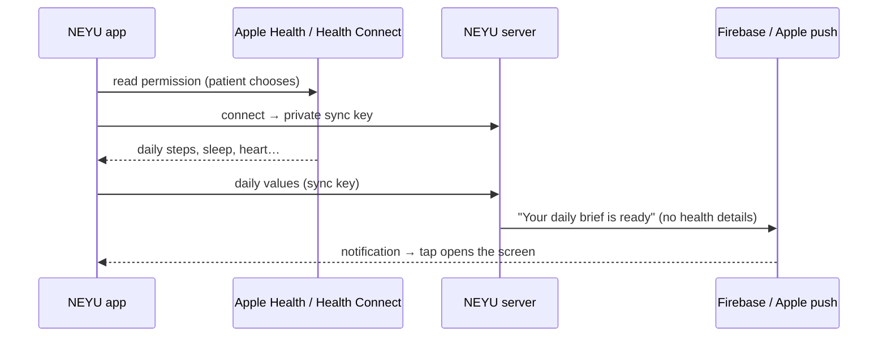
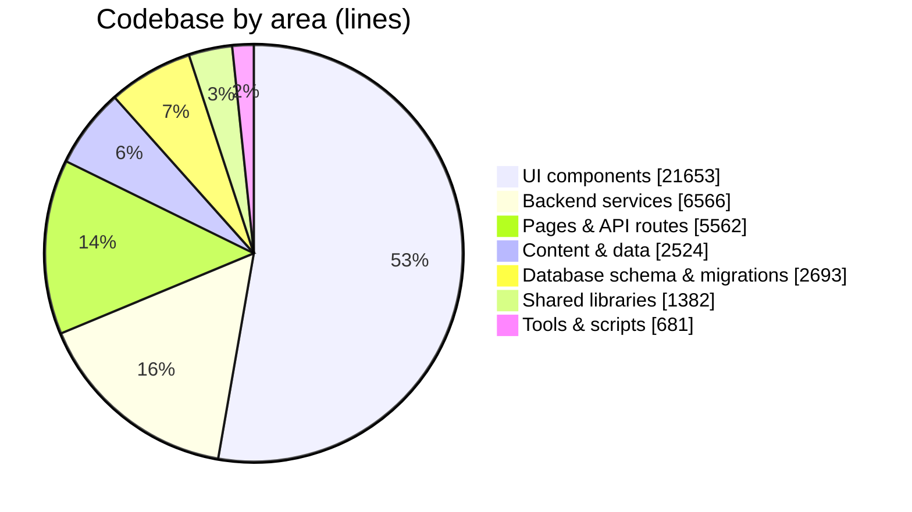

<p align="center">
  <a href="https://neyuhealth.com"></a>
</p>

<p align="center">
  <a href="https://neyuhealth.com"></a>
  
  
  
  
  
</p>

<h3 align="center">An AI-enabled health platform for cardiology, prevention and longevity — built in Calgary, Alberta.</h3>

<p align="center">
  <b><a href="https://neyuhealth.com">🌐 neyuhealth.com</a></b> &nbsp;·&nbsp;
  <a href="https://neyuhealth.com/my-health">My Health Space</a> &nbsp;·&nbsp;
  <a href="#-how-neyu-works">Architecture</a> &nbsp;·&nbsp;
  <a href="#-privacy--security-by-design">Privacy</a> &nbsp;·&nbsp;
  <a href="#-roadmap">Roadmap</a>
</p>

---

## ✦ What NEYU is

NEYU brings a cardiology clinic, a patient's own health data and an AI companion into one place.

| | For patients | For the clinic |
|---|---|---|
| **See** | Labs, wearables, blood pressure and visits in one timeline — *My Health Space* | Every patient, referral, request and AI conversation — the *Admin Console* |
| **Understand** | **Neyu**, the AI companion, explains results in plain language and prepares visit questions | Neyu flags emergency-sounding symptom checks for review first |
| **Act** | Book, prepare for visits, follow a protocol, earn streaks | Send reports, manage referrals and appointments, by role |
| **Control** | Choose which sources Neyu can read · download everything · delete the account | Every access is logged; sensitive records open only with a written reason |

> **Neyu never diagnoses.** It explains, organises and points to care. Anything that sounds like an emergency gets *“call 911”* first — on the patient side and on the server.

<p align="center"></p>

## ✦ How NEYU works

<p align="center"></p>



## ✦ Neyu — the AI layer



- **Reads reports** — a photo or PDF of a lab report becomes structured values the patient confirms.
- **Explains** — results, trends and visit prep in plain language, always with the evidence.
- **Notices** — meaningful changes in wearables and labs become insights (the patient can switch this off).
- **Consent first** — every AI permission change is recorded with the policy version (see Privacy).

## ✦ Privacy & security by design



| Layer | What protects the data |
|---|---|
| **Sign-in** | Own account per staff member · scrypt passwords · 2-step code (TOTP) · lock after 5 wrong tries · 8-hour sessions, only a hash of the token is stored |
| **Roles** | 6 roles × 19 permissions · nobody can hand out more power than they have · last super admin can't be removed |
| **Break-glass** | Roles marked *with reason* must write why before opening a record — saved in the audit log, access closes after 60 minutes |
| **Audit** | Every view, change, export, refusal and sign-in — append-only, searchable, with a 14-day activity chart and CSV export |
| **Files** | Reports and exports live outside the database, encrypted at rest with AES-256-GCM |
| **Patients in control** | Consent history with policy versions · email preferences + one-click unsubscribe · full data export (.zip) · account deletion with a 30-day hold and a deletion certificate |
| **Where data lives** | Canada · built for Alberta's *Health Information Act* and *PIPEDA* |



## ✦ The NEYU phone app

iPhone and Android app (Capacitor 8) around My Health Space and the website, built in the cloud by GitHub Actions. Setup and publishing: [`mobile/README.md`](mobile/README.md).

| Feature | |
|---|---|
| Apple Health · Health Connect | read only, patient chooses the data; last 30 days, then new days when the app opens |
| Push notifications | Firebase (Android) and Apple push sent by NEYU's own server; never health details on the lock screen |
| Face ID · fingerprint lock | on open and after 2 minutes away; the face or fingerprint never leaves the phone |
| Share sheet · camera | PDFs and exports to Files / Print / Mail; scan reports and meals |
| Withings · Oura · WHOOP | one-time signed link, sign-in in the phone's browser, back to the app |



## ✦ Built to scale

| Need | How |
|---|---|
| Millions of patients | PostgreSQL 16 with indexes per query path, BRIN index on the audit log, cursor pagination everywhere in `/api/v1` |
| Many app servers | Redis holds rate limits, sign-in guards, break-glass grants and cache — every server sees the same state |
| Slow work off the request | BullMQ background worker with retries: emails, data exports, account deletions, hourly jobs |
| Big files | Encrypted file storage (local disk today, S3-compatible next) — the database keeps only a key |
| Nothing single-point | Without Redis the app falls back to memory and keeps running; schedules re-register themselves |



## ✦ Quality

| Suite | Checks | Covers |
|---|---:|---|
| Staff sign-in | 38 | passwords, 2-step codes, lock-outs, replay protection, old shared password switch-off |
| Phase 3 platform | 101 | break-glass, staff management, audit, privacy, storage, Redis, worker, API v1 |
| Phase 4 admin & insights | 78 | .env super admin, admins with chosen features, live access changes, Insights, SEO |
| Phase 5 performance | 27 | one year of data: dashboards, daily totals, background jobs, health & metrics, caching |
| Phase 6 phone app — server | 67 | push to Android + iPhone (mock Firebase / Apple, signed keys checked), phones removed when gone, Health Connect / Apple Health sync, one-time sign-in links, daily brief on the phone |
| Phase 6 health data mapping | 19 | Apple Health / Health Connect → daily values: units, local days, sleep stages, naps |
| Phase 6 app in a browser | 51 | iPhone + Android with mocked phone features: connect, notifications, Face ID lock, share sheet, app links, offline |
| Phase 8 legal & consent | 31 | legal pages, consent versions, policy review, 18+ rule, statistics opt-out |
| Accessibility (axe, WCAG 2.1 AA) | 0 serious | 20 page views, desktop + phone |
| Patient API | 80 | My Health Space end to end |
| Postman / Newman | 116 | 81 requests across website, patient, admin, API v1, phone app and legal |
| **Total** | **608** | all passing |
| Load test (k6) | 200 at once | pages p95 0.23 s · My Health Space 0.50 s · dashboards 0.76 s · 0 errors |

## ✦ Roadmap

| Phase | | Status |
|---|---|---|
| 0 · Ship the current site | Live at neyuhealth.com | ✅ Done |
| 1 · System design | Architecture for millions of users | ✅ Done |
| 2 · Database | PostgreSQL 16, migrations, import, seed | ✅ Done |
| 3 · Core backend | Staff sign-in + 2-step, roles, break-glass, audit, privacy, file storage, Redis, worker, API v1 | ✅ Done |
| 4 · Admin dashboards | Super admin + admins with chosen features, Insights, SEO / AEO / GEO on every page | ✅ Done |
| 5 · Performance | Ready for 5,000 visitors a day: daily totals, background-warmed dashboards, cluster mode, monitoring, load tests | ✅ Done |
| 6 · Mobile app | iPhone & Android: Apple Health, Health Connect, push, Face ID, share sheet, cloud builds | ✅ Done (store publishing after Phase 8) |
| 7 · Devices | Apple Health · Health Connect (done in Phase 6) | ✅ Merged into 6 |
| 8 · Legal & trust | Privacy Policy, Terms, Neyu AI notice, Cookies, Accessibility; policy versions with review; 18+ rule; statistics opt-out; WCAG AA fixes | ✅ Done (company facts to confirm in `src/lib/legal.ts`) |
| 9 · Go live | Production rollout with DevOps | ◻ Planned |

## ✦ Stack

**Next.js 15** (App Router) · **React 18** · **TypeScript** · **PostgreSQL 16** + **Prisma** · **Redis** + **BullMQ** · **zod** · **Google Gemini** · **Resend** (email) · **Nginx** · **PM2** · **Docker** (local services)

## ✦ Repository map

```
src/app/            pages and API routes (src/app/api/v1 = versioned API)
src/components/     website, My Health Space and Admin Console UI
backend/            services: auth, access control, privacy, storage, queue, AI
prisma/             schema + migrations
scripts/            seed, import, staff accounts, worker, storage tools
postman/            API test collection
mobile/             iPhone + Android app (Capacitor): native projects, setup scripts, build guide
.github/workflows/  cloud builds of the phone app
deploy/             server setup for DevOps (Nginx, PM2, backups)
docs/               specs, design notes, LEGAL.md (keeping the legal pages correct)
```

**Developers:** setup, local services and tests are in [`docs/DEVELOPMENT.md`](docs/DEVELOPMENT.md). Server rollout is in [`deploy/README.md`](deploy/README.md).

<p align="center"><sub>© 2026 NEYU Health · Calgary, Alberta · <a href="https://neyuhealth.com">neyuhealth.com</a> · Neyu gives wellness information, not a diagnosis. In an emergency call 911.</sub></p>
